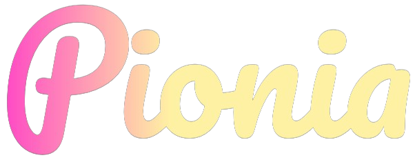

# Pionia Framework Official Documentation




Production docs can [be found here](https://pionia.netlify.app/).

## Getting Started

These instructions will get you a copy of the project up and running on your local machine for development and testing purposes.

### Prerequisites

- [Hugo](https://gohugo.io/)
- [Git](https://git-scm.com/)
- [Node.js](https://nodejs.org/)
- [Yarn](https://yarnpkg.com/)

### Installing

1. Clone the repository

```bash
git clone https://github.com/PioniaPHP-project/pionia-docs.git
```

2. Change into the project directory

```bash
cd pionia-docs
```

3. Install the dependencies

```bash
yarn install
```

4. Start the development server

```bash
yarn dev
```

## Contributing

1. Fork the repository
2. Create a new branch
3. Make your changes
4. Push your changes
5. Create a pull request
6. Wait for approval
7. If everything is okay, your changes will be merged
8. View your changes on the [production site](https://pionia.netlify.app/)

## License

This project is licensed under the MIT License - see the [LICENSE](LICENSE) file for details.

## Acknowledgments

- [Hugo](https://gohugo.io/)
- [Netlify](https://www.netlify.com/)
- [Doks](https://getdoks.org/)


## Validate documentation changes

Use the locked dependencies and build the site before checking its internal links:

```bash
npm ci
npm run lint:docs
npm run build
python3 bin/docs-links public
```

For visual changes, check the homepage and a tutorial page in both themes, at desktop and mobile widths. Verify search, the mobile navigation drawer, and code-copy buttons. The Hugo asset mounts explicitly expose the browser dependencies used by these controls.

Framework examples should match PioniaCore v3 source: `save()` returns a row object, `#[Can]` implies authentication, and middleware generators create empty hooks. The authentication tutorial includes separate local shopper and staff accounts so permission checks can be exercised.
